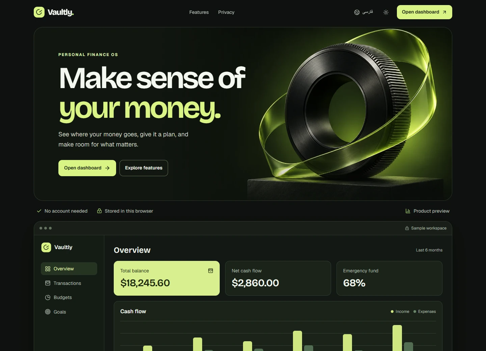
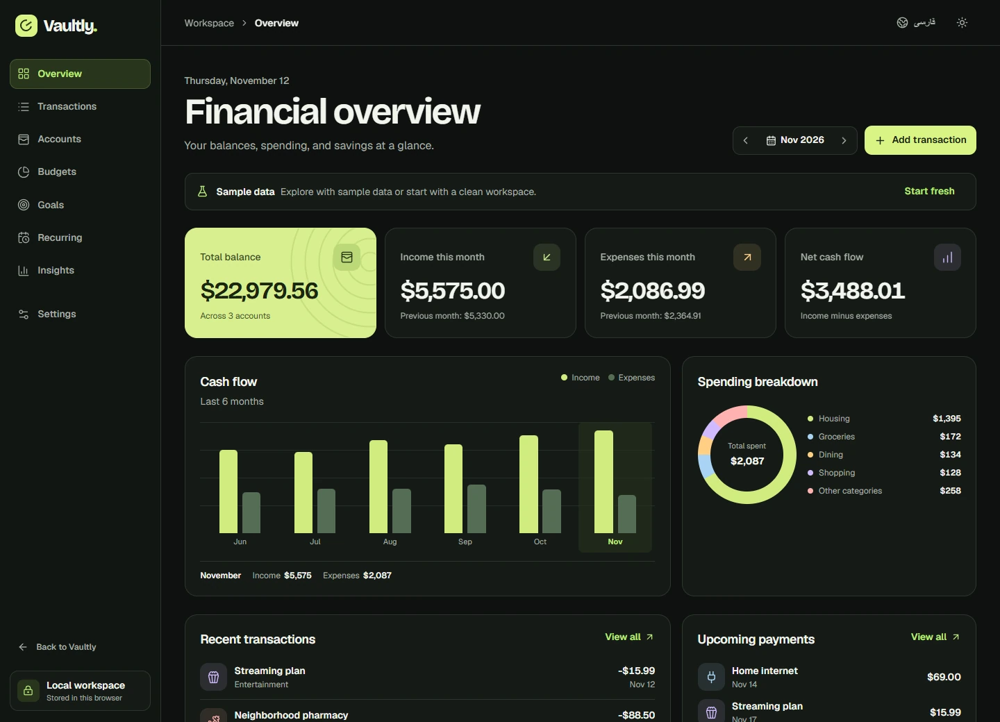
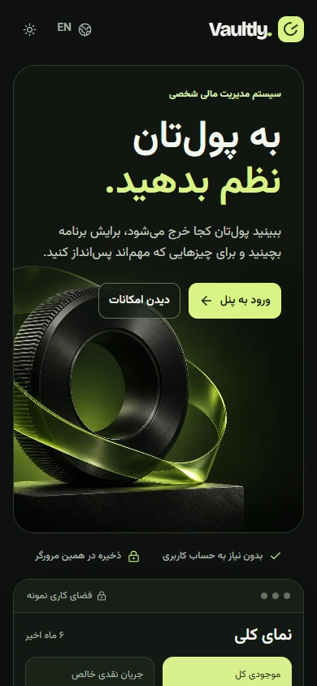
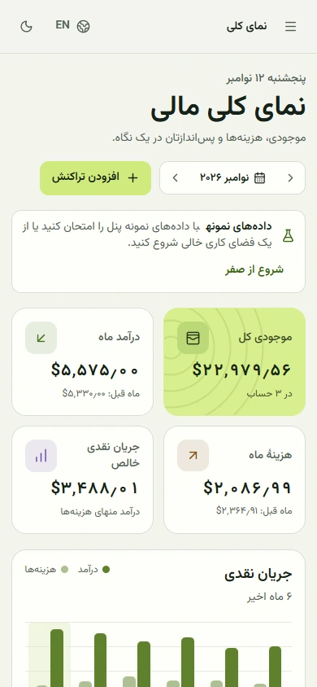

# Vaultly — Personal Finance OS

[](https://github.com/mmdbazooka/Vaultly/actions/workflows/verify.yml)

Vaultly is a bilingual, local-first finance workspace. Open the dashboard to explore a sample ledger, then start fresh with your own accounts and plans. The app stores workspace data in the current browser.





<table>
  <tr>
    <td></td>
    <td></td>
  </tr>
</table>

## What you can do

| Page         | Workflow                                                                                                     |
| ------------ | ------------------------------------------------------------------------------------------------------------ |
| Overview     | See account balances, six months of cash flow, recent transactions, upcoming payments, and savings progress. |
| Transactions | Add and edit income, expenses, and transfers. Search, filter, and download a CSV of the results.             |
| Accounts     | Track starting and current balances for bank accounts, savings, credit cards, and cash.                      |
| Budgets      | Set monthly spending limits by category and see how much is left.                                            |
| Goals        | Track target amounts, optional deadlines, and recorded contributions.                                        |
| Recurring    | Track bills and subscriptions, pause schedules, and record a payment in the ledger.                          |
| Insights     | Compare monthly cash flow, savings rate, and spending by category.                                           |
| Settings     | Switch language, theme, and display currency. Download or restore a versioned JSON backup.                   |

The English interface uses Geist and Bricolage Grotesque. The Persian interface uses Vazirmatn and a right-to-left layout. Light, dark, and system themes are available.

## Run locally

Use Node.js 22 or later.

```sh
npm ci
npm run dev
```

Open [the local app](http://localhost:3000). The landing page is at `/`. Localized workspaces are at `/en/dashboard/` and `/fa/dashboard/`.

## Architecture

- **Next.js App Router and TypeScript** provide localized routes and a static build. Tailwind CSS utilities and shared CSS variables provide the layout and theme.
- **TanStack Query** manages the current workspace, serializes writes, and refreshes the cache on storage changes from another tab. The storage adapter validates the entire versioned document before writing to `localStorage` and uses Web Locks for cross-tab writes when available.
- **Finance logic** in `src/lib/finance` stores amounts in integer minor units, excludes transfers from income and spending, and commits each recorded recurring payment together with its next due date. Dates use Gregorian accounting months. Currency selection changes the displayed unit while keeping recorded amounts.
- **Shared controls** include buttons, fields, dialogs, metrics, empty states, month navigation, and charts. Feature pages compose these controls inside a responsive workspace shell.

Browser storage belongs to the current origin and browser profile. Use Settings to export a backup before moving to another browser or clearing site data.

## Checks and production build

```sh
npm run format:check
npm run lint
npm run typecheck
npm test
npm run build
```

The production build outputs a static site in `out/`. Deploy that directory to a static host with directory index support.

On Windows, the build normalizes exported App Router segment filenames for client navigation. [Next.js upstream issue](https://github.com/vercel/next.js/issues/85374)

## Landing artwork

The landing artwork was generated with the built-in ImageGen tool and optimized to WebP for the site. [Production asset](public/vault-hero.webp)

<details>
<summary>Image generation prompt</summary>

```text
Use case: product-mockup. Asset type: wide hero photograph for the right half of a premium personal finance web app named Vaultly. Landscape approximately 3:2. A single sculptural, monolithic blackened aluminum safe-dial form, front-facing at a slight three-quarter angle, a hollow circular mechanical dial with finely ribbed knurled rim, surrounded by one gracefully folded ribbon of translucent acid-lime green glass. Fine matte black stone pedestal at bottom, crisp physically realistic reflections, dark charcoal olive seamless studio backdrop (#111612), directional lime backlight, tactile industrial materials, restrained luxury editorial product photography, crisp high contrast. Large object fills the composition on the center-right, with generous dark breathing room on left and at the edges, and the top and bottom edges fading to deep green-black for blending into a webpage. Lime shades #d8f982 and green-gray highlights. Sophisticated, simple composition, deliberate negative space. No lettering, no logos, no numbers, no UI, no coins, no clutter, no humans, no neon bloom.
```

</details>
